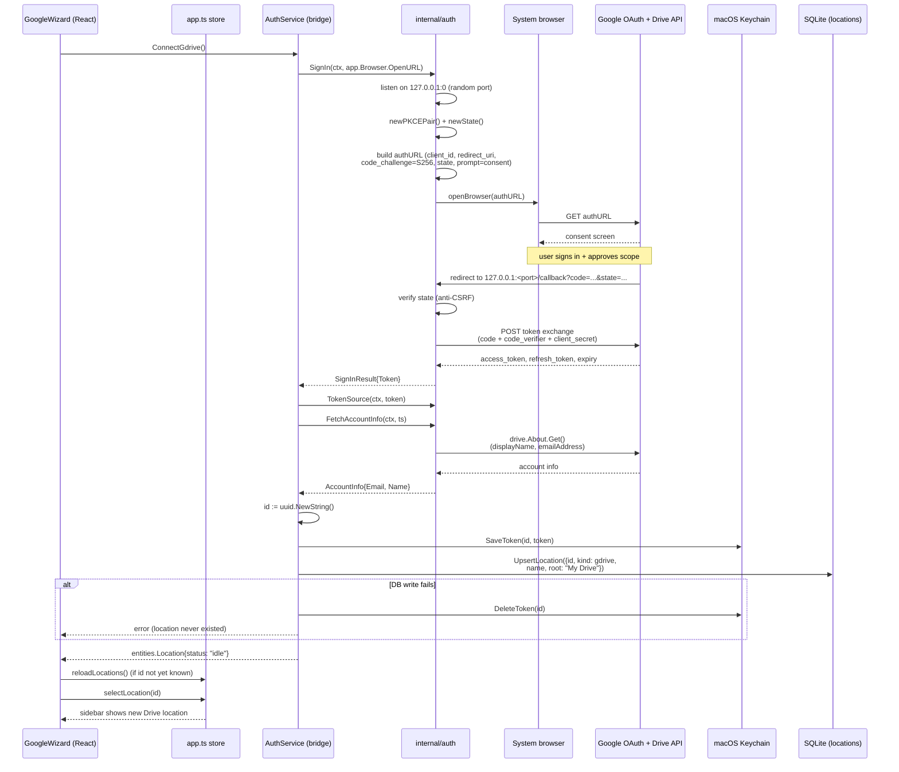

# Google Drive auth — how sign-in reaches a sidebar location

## Why a loopback server, not a redirect URI scheme

Wails apps have no HTTP(S) URL of their own to receive an OAuth redirect.
The standard fix for native/desktop apps (RFC 8252) is a **loopback
redirect**: start a tiny HTTP server on `127.0.0.1:<ephemeral port>`, tell
Google to redirect there, and shut it down once the one request it cares
about (`/callback`) arrives. `internal/auth/loopback.go:SignIn` does exactly
this — one `net.Listen("tcp", "127.0.0.1:0")` per sign-in attempt, torn down
via `defer srv.Shutdown(...)` regardless of outcome.

## PKCE (why there's still a `code_verifier` even with a client secret)

Every sign-in generates a fresh PKCE pair (`internal/auth/oauth.go:newPKCEPair`):
a random `verifier` and its SHA-256 `challenge`. The challenge goes out in the
authorize URL; the verifier is only ever sent in the final token-exchange
request, over HTTPS, straight from our process to Google. This defeats
authorization-code interception on the loopback redirect (a local process
could in principle see the callback URL, but not the verifier). It's
required for all installed-app OAuth flows per Google's guidance, on top of
the client secret — see the code comment in `oauth.go` for why the secret is
still needed even though PKCE alone would suffice per RFC 7636.

## Where things live afterward

| What | Where | Notes |
|---|---|---|
| Access + refresh token | macOS Keychain, service `AirDrive`, account = `locationID` | Never touches SQLite — `internal/auth/keyring.go` |
| Location row | SQLite `locations` table, `kind = "gdrive"` | `status` starts `"idle"`; no crawl runs (see scope note) |
| Silent refresh | `auth.TokenSource` wraps `oauth2.Config.TokenSource` | Used whenever a future `gdrive.Provider` needs a live token |

`RemoveLocation` (`internal/bridge/location_service.go`) calls
`auth.DeleteToken(locationID)` before deleting the DB row, so removing a
Google Drive location from the sidebar also cleans up its Keychain item — a
location is never left with an orphaned credential, and vice versa (the
`ConnectGdrive` flow above rolls back the Keychain token if the DB write
fails).

