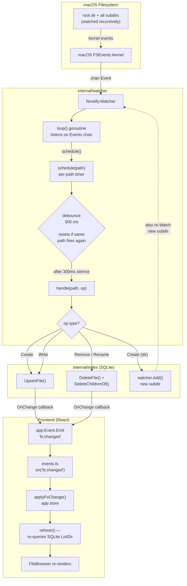

# Watcher — how filesystem changes reach the UI

## Total latency

| Step | Time |
|---|---|
| Debounce | 300 ms |
| SQLite read (`ListDir`) | ~10 ms |
| React re-render | ~16 ms |
| **Total** | **~326 ms** |

## Key design decisions

- **Debounce** — editors write files in multiple rapid bursts; the 300 ms window coalesces them into one index update instead of hammering SQLite.
- **Recursive watching** — `Watch()` walks the entire tree with `filepath.WalkDir` and calls `fsnotify.Add` on every subdirectory. When a new directory is created, `handle()` calls `Add` on it too so newly created subdirs are immediately watched.
- **`DeleteChildrenOf`** — when a directory is deleted from Finder, a single `DELETE WHERE id LIKE 'path/%'` removes the whole subtree from the index in one query.
- **`OnChange` callback** — the watcher knows nothing about Wails; it calls a plain Go function that `main.go` wires to `app.Event.Emit`, keeping the watcher package free of Wails imports.
